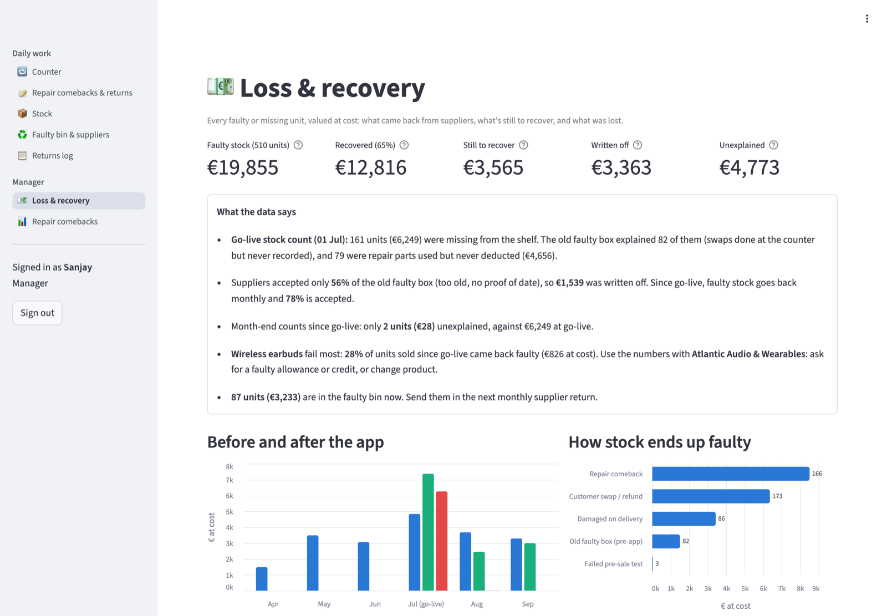
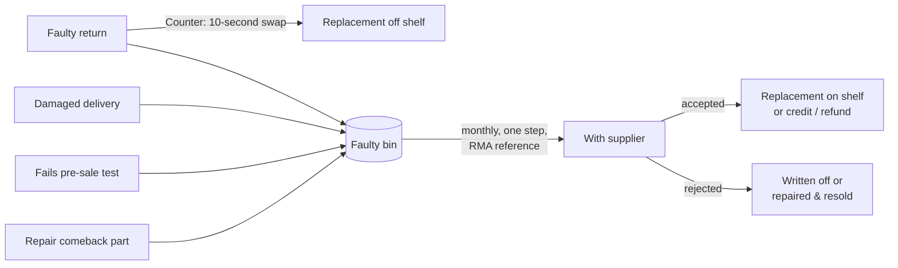
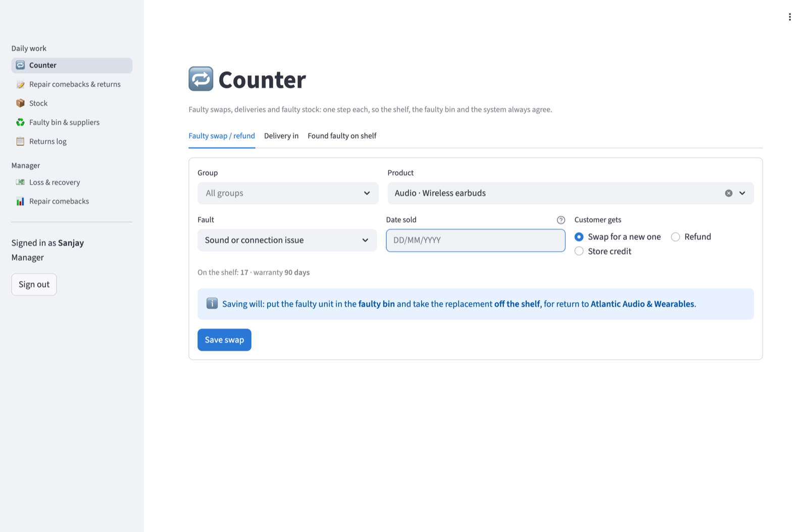
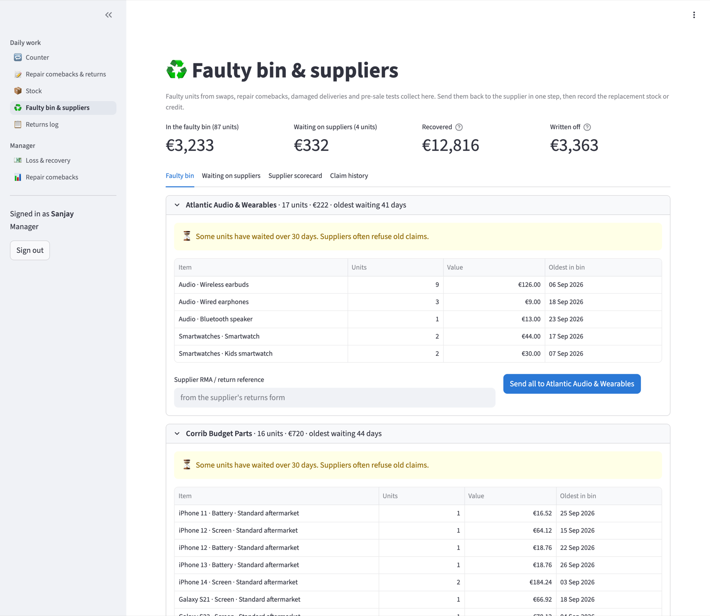
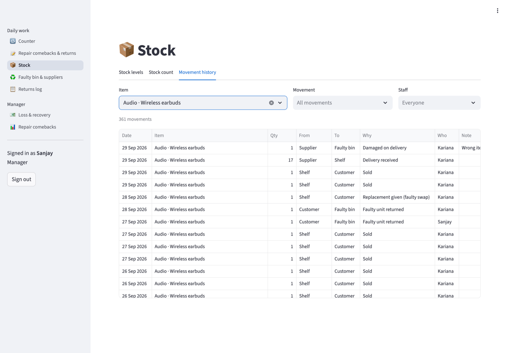
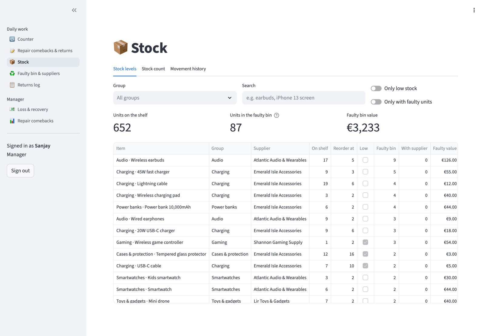
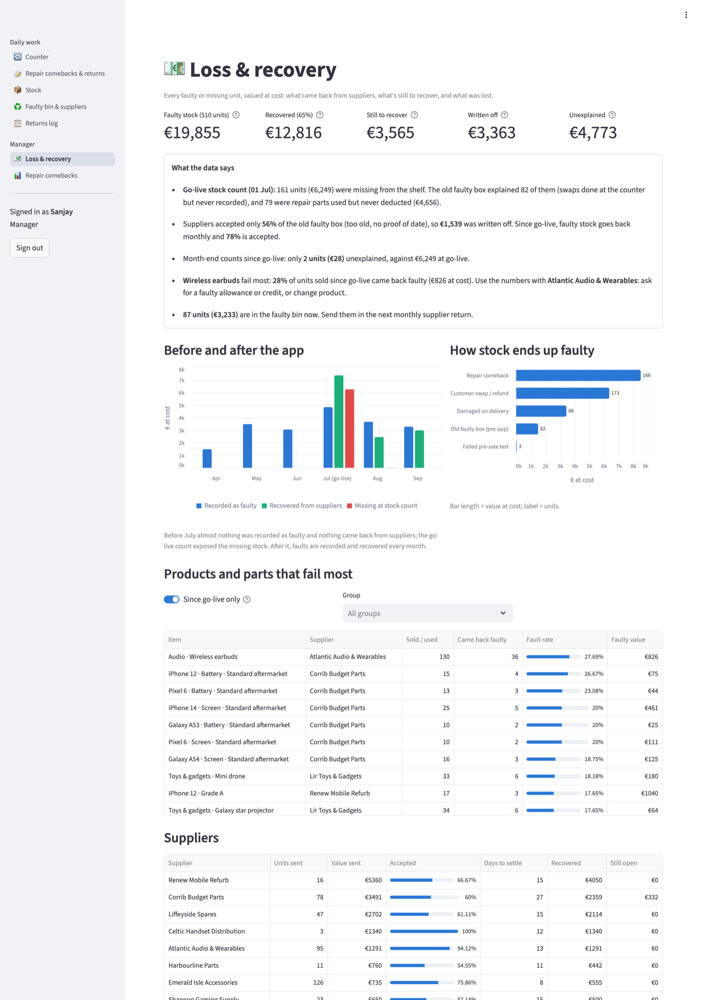
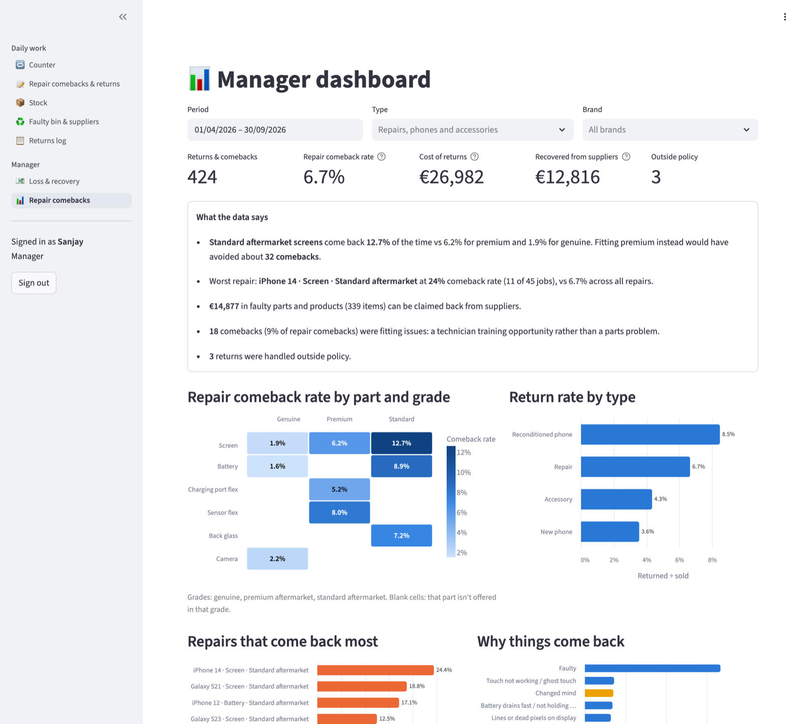

# Faulty Stock & Returns Tracker

**Recovering the silent loss from faulty stock in a phone repair & electronics shop.**

In a typical phone shop, 2 to 4 in every 10 wireless earbuds come back faulty. Staff swap them at the counter, write "faulty" on the box and drop it in a box under the counter. The system is never told, the box never goes back to the supplier, and at stock-take the system says 6 when the shelf has 3. The same happens with chargers, smartwatches, gaming controllers, toys, and repair parts used but never deducted.

This app makes the right thing the fastest thing. A **faulty swap takes one 10-second step** that keeps stock correct. Faulty stock is **sent back to suppliers in one step** and tracked until replacement stock or credit arrives, and the manager sees **exactly how much was lost, recovered and still to recover**.

**Live demo:** _link coming after deployment_ · **Requirements:** [docs/requirements.md](docs/requirements.md)
**Try it:** the sign-in page has one-click **Try as Manager / Technician / Sales** buttons. All data, staff and supplier names are fictional.



---

## The problem, in numbers (demo data)

The demo simulates six months in a shop, with the app going live on 1 July:

| | Before the app (Apr–Jun) | After the app (Jul–Sep) |
|---|---|---|
| Faulty swaps recorded | ~30% | 100% |
| Faulty stock sent back to suppliers | Never | Monthly |
| Supplier acceptance | 56% (the old box: too old, no proof) | 78% |
| Unexplained stock at counts | **€6,249** missing at the go-live count | **€28** across two month-end counts |

At the go-live stock count, **82 units** missing from the shelf turned out to be in the old faulty box (swaps never recorded), and **79 repair parts** had been used but never deducted. **€12,800** has since been recovered from suppliers. **Wireless earbuds fail 28% of the time**, which gives the shop hard evidence to ask its supplier for a faulty allowance or to change product.

## How it works



**Every unit that moves is recorded** (from → to, why, when, who) in a stock ledger. Stock in any location is calculated from that ledger and never typed over. That's what answers "where did it go and who took it", and why a stock count difference is always traceable.

| Page | For | What it does |
|---|---|---|
| **🔁 Counter** | Sales staff | Faulty swap / refund in one step (warranty check, shelf count); book in deliveries with damaged units; move faulty units off the shelf |
| **📦 Stock** | Everyone | Units on the shelf, in the faulty bin and with suppliers; low-stock flags; stock count with difference in units and €; full movement history by item, movement type and person |
| **♻️ Faulty bin & suppliers** | Everyone | Bin grouped by supplier with how long units have waited; send everything to a supplier in one step; record replacement stock, credit, refund or rejection; supplier scorecard |
| **💶 Loss & recovery** | Manager | Faulty value, recovered, still to recover, written off, unexplained; before/after go-live by month; how stock ends up faulty; fault rate by product; supplier performance; written insights |
| **📝 Repair comebacks & returns** | Technicians & staff | Repair comebacks by device · part · grade with 90-day warranty and responsibility; phone and non-faulty returns |
| **📊 Repair comebacks** | Manager | Comeback rate by part × grade, worst repairs, bad-batch alerts |

| Counter: faulty swap | Faulty bin, grouped by supplier |
|---|---|
|  |  |
| **Movement history: who moved what** | **Stock levels** |
|  |  |

<details>
<summary>Full Loss & recovery page, and the repair comebacks dashboard</summary>




</details>

## How I approached it

1. **Started from a real problem.** I work in phone retail, and the swap-and-forget pattern for faulty earbuds is something I've seen happen. I wrote it up as a [requirements document](docs/requirements.md): problem statement, success measures, stakeholders, 17 user stories with acceptance criteria, business rules, data model, and current vs future process.
2. **Designed for adoption.** The counter flow is one screen and one button, because if recording a swap is slower than not recording it, it won't happen.
3. **Chose a movement ledger over a stock number,** so every difference is explainable.
4. **Built and tested it.** Python, Streamlit and SQLite, with 20 automated tests on the stock rules (swaps, damaged deliveries, supplier returns, stock counts) and the policy rules, plus end-to-end checks in a browser.

## Run it locally

```bash
git clone https://github.com/sanjayprakash-git/returns-tracker.git
cd returns-tracker
python3 -m venv .venv && source .venv/bin/activate
pip install -r requirements.txt
streamlit run app.py
```

Demo data is generated on first start; delete `data/returns.db` to regenerate it. Run the tests with `python -m unittest`. Set `RETURNS_TRACKER_DEMO=0` to hide the one-click demo sign-in. Streamlit keeps sign-in per browser session, so refreshing the page signs you out.

## Project structure

```
app.py                  Sign-in and role-based navigation
views/                  Counter, stock, faulty bin & suppliers, loss & recovery, returns, repair dashboard
tracker/stock.py        Stock ledger: swaps, deliveries, supplier returns, stock counts, levels
tracker/recovery.py     Loss & recovery figures, fault rates, supplier scorecard, insights
tracker/db.py           SQLite schema and queries
tracker/policy.py       Warranty and returns rules, reasons, responsibility
tracker/analytics.py    Repair comeback analysis
tracker/auth.py         Sign-in (salted PBKDF2 hashes) and demo accounts
tracker/seed.py         Demo data: six months of a shop, before and after the app
tests/                  Stock, policy, analytics, auth and seed tests
docs/requirements.md    Requirements, user stories, data model, process diagrams
```

**Stack:** Python · Streamlit · SQLite · pandas · Altair

## What I'd do next

- Barcode scanning at the counter, to make a swap faster still
- POS integration so sales don't need entering twice
- Photo upload of damaged deliveries as evidence for supplier claims
- A hosted database and multi-branch support

---

Built by [Sanjay Prakash Ravi](https://sanjayprakash.vercel.app/) · [LinkedIn](https://linkedin.com/in/sanjay-prakash-a92291186)
