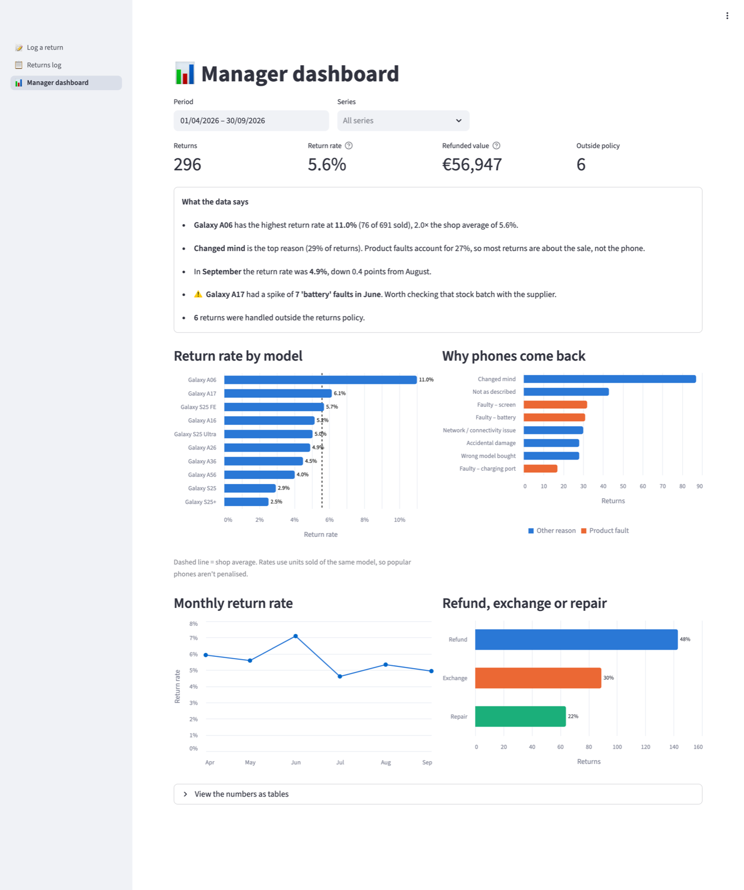
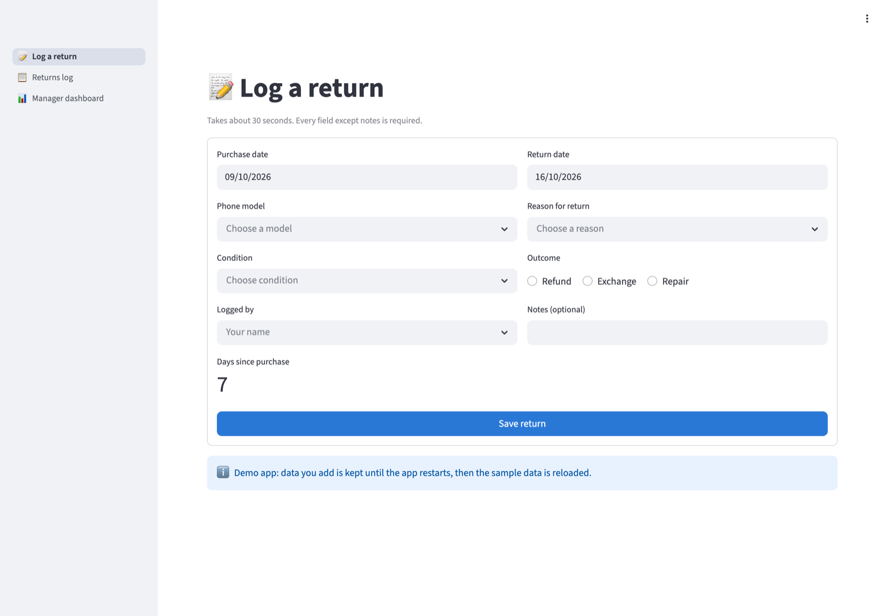
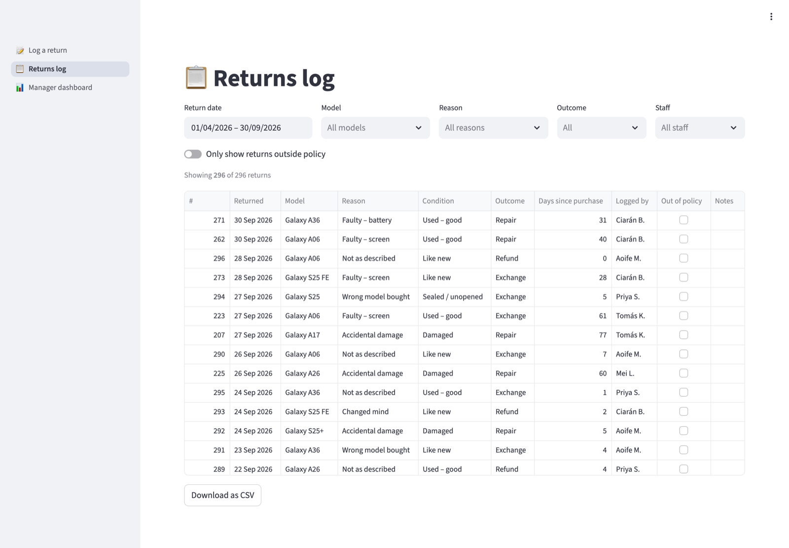

# Returns Tracker

A returns tracking and analysis app for a phone shop selling Samsung Galaxy A-series and S-series phones. Staff log each return in about 30 seconds, and the manager gets a dashboard showing which models come back, why, and whether it's getting better or worse.

**Live demo:** _link coming after deployment_ · **Requirements:** [docs/requirements.md](docs/requirements.md)



---

## The problem

In a typical phone shop, returns are recorded inconsistently: a note in the POS, a paper slip, or nothing at all when a phone is swapped on the spot. So the manager can't answer simple questions. Which model has the most returns? Is it faults or buyer's remorse? Are we refunding outside policy? Without return *rates* (returns ÷ units sold), popular models also look worse than they are.

## How I approached it

1. **Requirements first.** I wrote the [requirements document](docs/requirements.md): problem statement, stakeholders, 10 user stories with acceptance criteria, business rules, the data model, and the current vs future returns process as diagrams.
2. **Data model.** Four tables (products, staff, sales, returns), so return rates can be calculated against sales and every return is linked to a model and a staff member.
3. **Build.** A Streamlit app on SQLite with three pages: log a return, a filterable returns log, and a manager dashboard.
4. **Policy built into the form.** The form calculates days since purchase and warns at the counter when a refund would break policy, for example a change-of-mind refund after 14 days.

## What it does

| Page | For | Features |
|---|---|---|
| **Log a return** | Shop staff | Dropdowns for model, reason and condition; automatic days-since-purchase; live policy warnings; validation |
| **Returns log** | Manager | Filter by date, model, reason, outcome and staff; show only out-of-policy returns; CSV export |
| **Manager dashboard** | Manager | Return rate by model, top reasons (faults vs. other), monthly trend, refund/exchange/repair split, refunded value, and automatically written insights |

| Log a return, with a policy warning | Returns log |
|---|---|
|  |  |

## What the demo data shows

The demo uses generated data (6 months, about 5,300 phones sold and about 300 returns), built with realistic patterns for the dashboard to find:

- **The budget Galaxy A06 is returned twice as often as average** (11.0% vs 5.6%), mostly for change of mind and "not as described". That points to how it's sold rather than to faults.
- **Product faults are only about a quarter of returns.** Most returns are about the sale (expectations, wrong model), which staff training can address.
- **The Galaxy A17 had a battery-fault spike in June and July.** The dashboard flags it automatically as a batch to raise with the supplier.
- **6 returns were refunded outside policy.** The new form warns staff before this happens.

No real customer or shop data is used.

## Run it locally

```bash
git clone https://github.com/sanjayprakash-git/returns-tracker.git
cd returns-tracker
python3 -m venv .venv && source .venv/bin/activate
pip install -r requirements.txt
streamlit run app.py
```

The database is created and filled with demo data on first start. To regenerate it, delete `data/returns.db`.

Run the tests with `python -m unittest`.

## Project structure

```
app.py                 Entry point and page navigation
pages/                 Log a return, returns log, manager dashboard
tracker/db.py          SQLite schema and queries
tracker/policy.py      Reference values and returns-policy rules
tracker/analytics.py   Return rates, trends and generated insights
tracker/seed.py        Demo data generator
tests/                 Tests for policy rules and dashboard maths
docs/requirements.md   Requirements, user stories, data model, process diagrams
```

**Stack:** Python · Streamlit · SQLite · pandas · Altair

## What I'd do next

- Connect to the POS so sales and returns don't need entering twice
- Add logins so staff see the form and managers see the dashboard
- Track repairs through to completion and calculate supplier claim value
- Move to a hosted database so data persists across restarts

---

Built by [Sanjay Prakash Ravi](https://sanjayprakash.vercel.app/) · [LinkedIn](https://linkedin.com/in/sanjay-prakash-a92291186)
