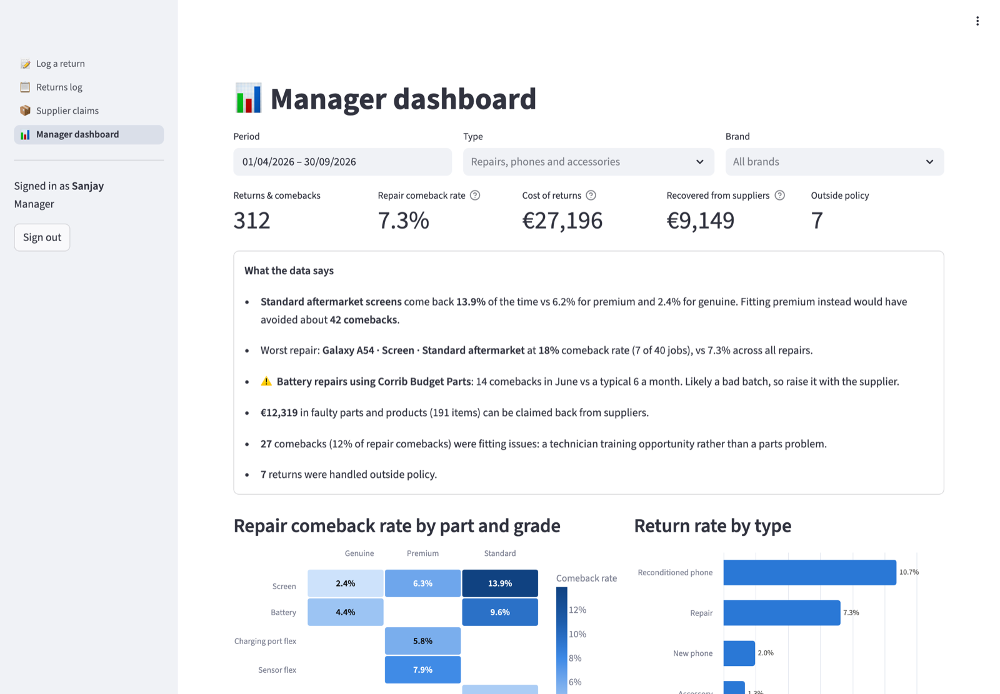
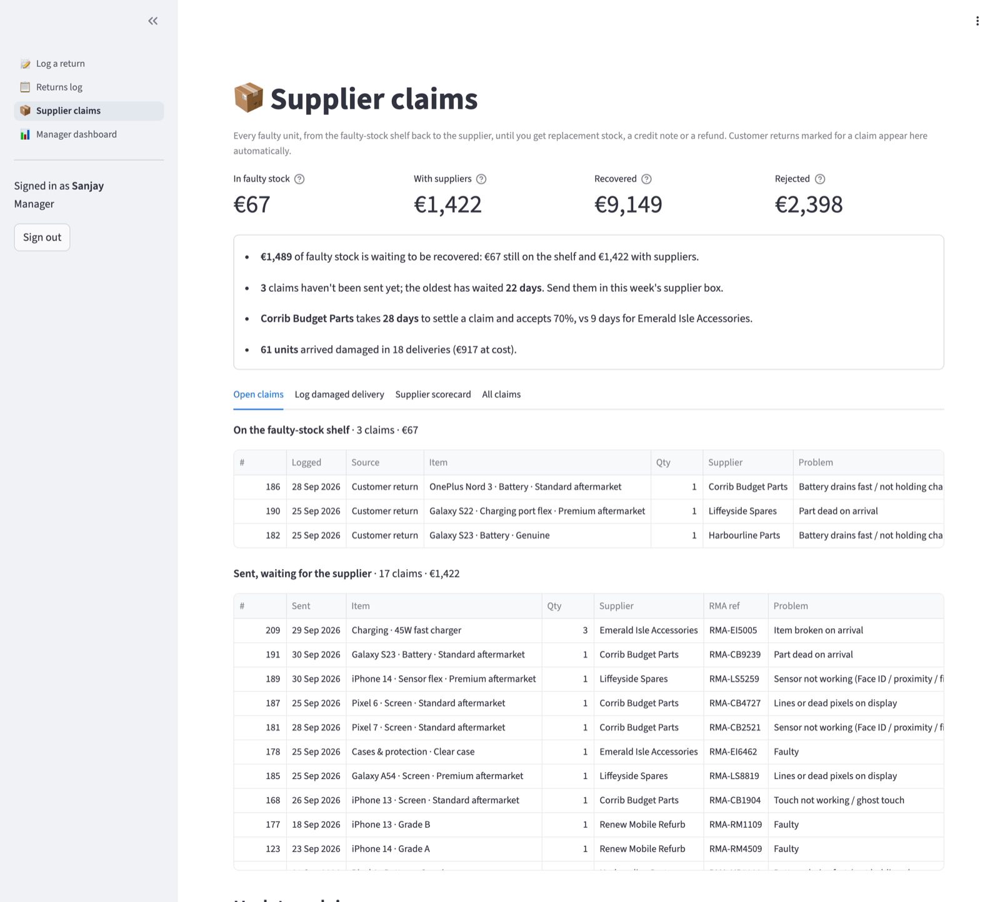
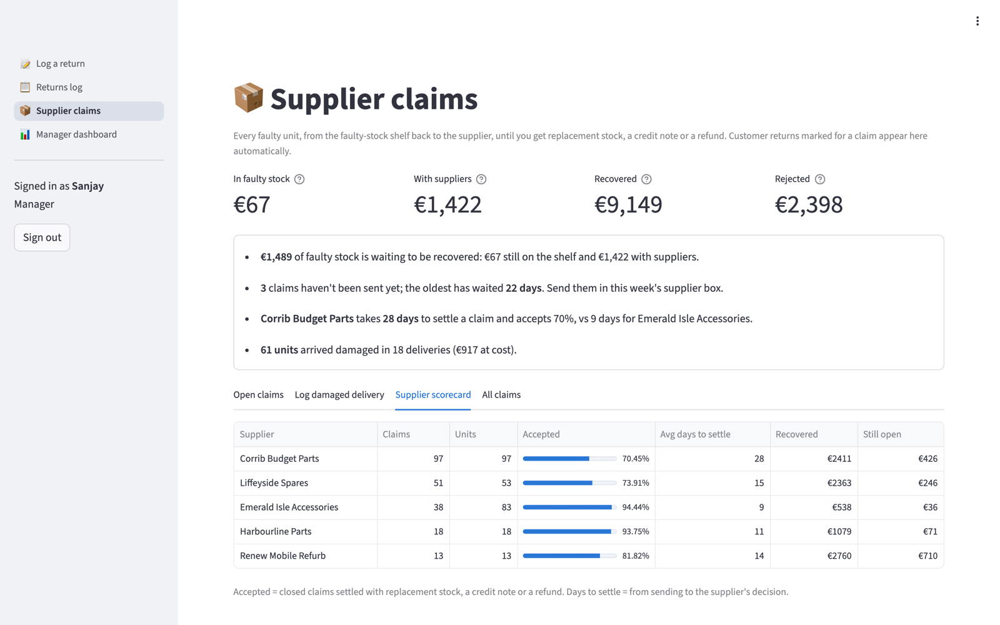
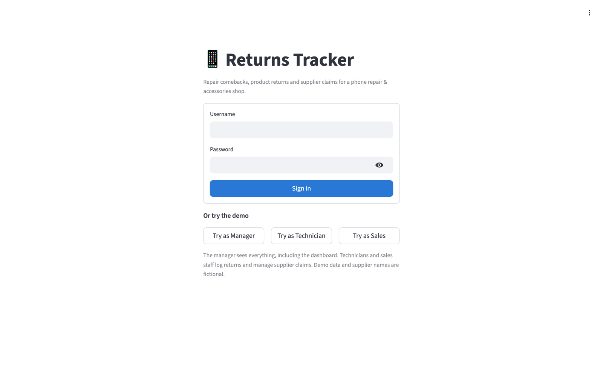

# Returns Tracker

A comeback, returns and supplier-claims tracker for a phone repair & accessories shop. Technicians and sales staff log anything that comes back in about 30 seconds: a repair comeback, a new or reconditioned phone, or an accessory. Faulty units then go into faulty stock and are tracked back to the supplier until replacement stock, a credit note or a refund arrives, and so does stock that arrives damaged. The manager gets a dashboard showing which parts, grades and suppliers fail, what returns cost, and what's been recovered.

**Live demo:** _link coming after deployment_ · **Requirements:** [docs/requirements.md](docs/requirements.md)

**Try it:** the sign-in page has one-click **Try as Manager / Technician / Sales** buttons. All demo data, staff and supplier names are fictional.



---

## The problem

In a repair shop, most of what comes back is repair comebacks: a replacement screen with ghost touch or lines, a battery that drains fast, a sensor flex that stops Face ID or the fingerprint reader working. These usually get re-done at the counter with nothing recorded, so the shop can't answer:

- Are cheaper aftermarket screens a false economy?
- Which supplier's parts are failing, and is it a bad batch?
- How much credit are we losing by binning faulty parts instead of claiming them?
- Is it the part, or the fitting?
- What happens to the faulty unit after the customer is refunded, and to stock that arrives damaged? Did the replacement or credit ever arrive?

## How I approached it

1. **Requirements first.** I wrote the [requirements document](docs/requirements.md): problem statement, stakeholders, 17 user stories with acceptance criteria, business rules (warranty and returns policy), the data model, and current vs future process diagrams.
2. **Data model.** One `items` table covers repair jobs (device, part, grade, supplier), phones and accessories, so comeback and return rates use one formula: returns ÷ jobs or units sold.
3. **Build.** A Streamlit app on SQLite with staff sign-in and four pages: log a return, a filterable returns log, supplier claims, and a manager dashboard.
4. **Rules built into the form.** Reasons and outcomes adapt to what's coming back. The form calculates days since repair or purchase, warns about out-of-policy decisions (such as a free re-repair after the 90-day warranty), and suggests a supplier claim when a part is faulty.

## What it does

| Page | For | Features |
|---|---|---|
| **Sign in** | Everyone | Username and password (salted hashes); role decides which pages you see; "Logged by" comes from the signed-in user |
| **Log a return** | Technicians & sales staff | Type → brand or accessory group → exact item (e.g. *iPhone 13 · Screen · Standard aftermarket*); reason and outcome lists that fit the type; automatic days and responsibility; policy warnings; supplier claim suggestion |
| **Returns log** | Manager | Filter by date, type, brand, reason and outcome; show only out-of-policy cases or supplier claims; running cost; CSV export |
| **Supplier claims** | All staff | Faulty stock from customer returns (automatic), damaged deliveries and pre-sale test failures, with quantities; claim status from faulty stock → sent (RMA reference) → closed with replacement stock, credit note, refund or rejection; money in faulty stock, with suppliers, recovered and rejected; supplier scorecard (acceptance rate, days to settle) |
| **Manager dashboard** | Manager only | Comeback rate by part × grade, return rate by type, worst repairs, reasons by responsibility (part fault, workmanship, customer damage, sale-related), monthly trend, accessory returns by group, outcomes, cost of returns, claimable value, and automatically written insights |

| Log a return: warranty warning and supplier claim | Supplier claims: faulty stock to recovered value |
|---|---|
|  |  |
| **Supplier scorecard** | **Sign in with demo logins** |
|  |  |

<details>
<summary>Full dashboard</summary>


</details>

## What the demo data shows

The demo uses generated data: 6 months, about 7,500 repair jobs and sales, and about 310 returns (73% repair comebacks), with patterns for the dashboard to find:

- **Standard aftermarket screens come back 13.9% of the time**, vs 6.2% for premium and 2.4% for genuine. Fitting premium instead would have avoided about 40 comebacks.
- **A bad battery batch from one supplier** shows up as 14 comebacks in June against a typical 6 a month. The dashboard flags it automatically.
- **About €9,100 was recovered from suppliers** (replacement stock, credit notes and refunds) once faulty units were tracked instead of binned.
- **12% of repair comebacks are fitting issues**, which points to technician training rather than parts.
- **The budget parts supplier takes 28 days to settle a claim and accepts 70%**, vs 9 days for the accessories supplier. **61 units arrived damaged** across 18 deliveries.

No real customer, supplier or shop data is used; supplier and staff names are fictional.

## Run it locally

```bash
git clone https://github.com/sanjayprakash-git/returns-tracker.git
cd returns-tracker
python3 -m venv .venv && source .venv/bin/activate
pip install -r requirements.txt
streamlit run app.py
```

The database is created and filled with demo data on first start. To regenerate it, delete `data/returns.db`. Run the tests with `python -m unittest`.

Note: Streamlit keeps sign-in per browser session, so refreshing the page signs you out.

## Project structure

```
app.py                 Entry point and page navigation
views/                 Log a return, returns log, supplier claims, manager dashboard
tracker/db.py          SQLite schema, queries, supplier claims and cost-of-return rules
tracker/auth.py        Staff sign-in (salted PBKDF2 password hashes)
tracker/state.py       Shared database connection
tracker/policy.py      Reference values, warranty/returns policy, responsibility
tracker/analytics.py   Comeback rates, spike detection, claims scorecard and generated insights
tracker/seed.py        Demo data generator
tests/                 Tests for policy rules and dashboard maths
docs/requirements.md   Requirements, user stories, data model, process diagrams
```

**Stack:** Python · Streamlit · SQLite · pandas · Altair

## What I'd do next

- Connect to the repair-ticket and POS system so jobs and sales don't need entering twice
- Record the technician on each job to compare comeback rates fairly
- Move to a hosted database so data persists and several branches can share it
- Link replacement stock to inventory levels and add photo uploads for damaged deliveries

---

Built by [Sanjay Prakash Ravi](https://sanjayprakash.vercel.app/) · [LinkedIn](https://linkedin.com/in/sanjay-prakash-a92291186)
