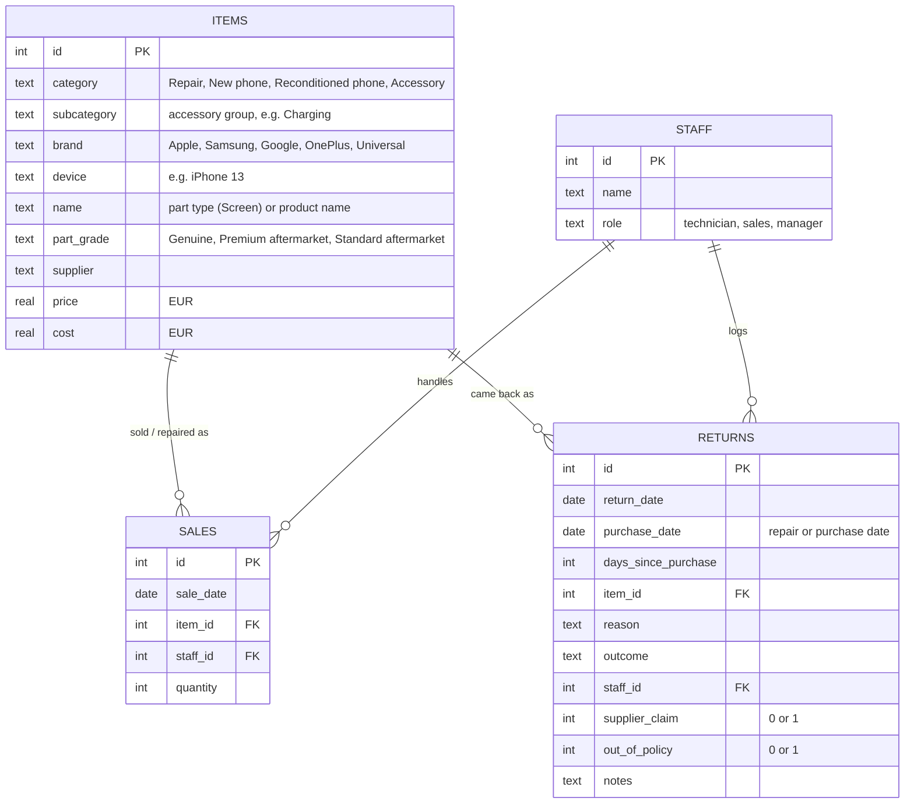
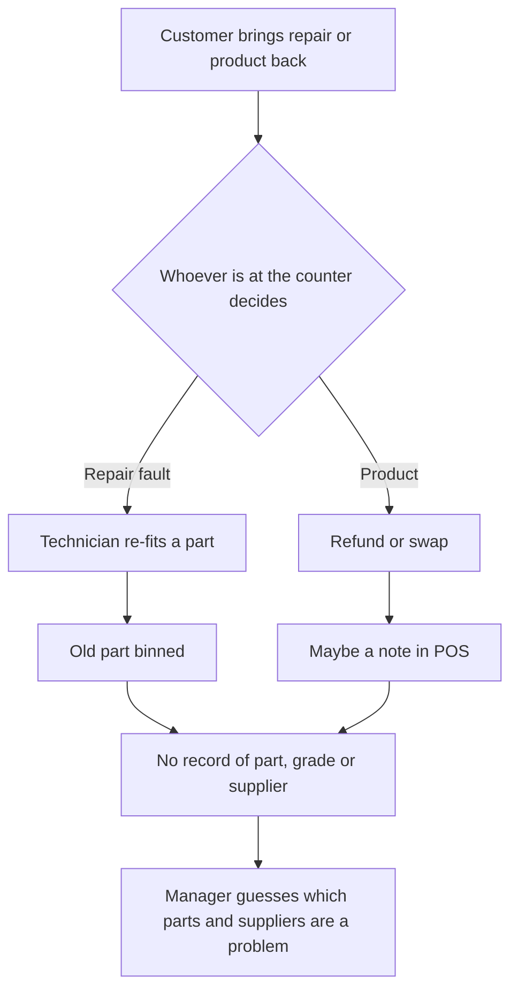
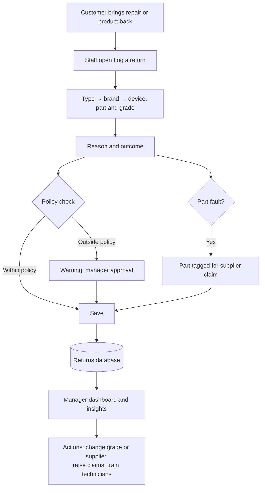

# Returns Tracker — Requirements

**Project:** Repair comeback and returns tracking for a phone repair & accessories shop
**Author:** Sanjay Prakash Ravi
**Status:** v2.0

---

## 1. Problem statement

The shop repairs phones (Apple, Samsung, Google Pixel, OnePlus) and sells new phones, reconditioned phones and accessories. Most of what comes back is **repair comebacks**: a fitted screen with ghost touch or lines, a replacement battery that drains fast, a sensor flex that stops Face ID or the fingerprint reader working. The rest are product returns.

Today these are handled at the counter and re-repaired, refunded or swapped, but rarely recorded in a structured way. As a result:

- **Nobody knows which parts fail.** The shop can't tell whether a standard aftermarket screen is a false economy compared with a premium or genuine one.
- **Supplier credit is lost.** Faulty parts are binned instead of sent back for a claim (RMA), because there's no record of which supplier and batch they came from.
- **Bad batches are spotted late.** A run of faulty batteries is only noticed after many customers have come back.
- **Workmanship and part faults get mixed up.** Without a reason code, a fitting issue looks the same as a faulty part, so technician training needs are invisible.
- **Warranty and returns policy is applied inconsistently.** Free re-repairs are given after the 90-day warranty, and change-of-mind refunds after 14 days.

**Goal:** give staff a 30-second way to log every comeback and return in a consistent format, and give the manager a dashboard that shows which parts, grades and suppliers come back, what it costs, and how much can be claimed back.

### Success measures

| Measure | Target |
|---|---|
| Comebacks and returns logged | 100% (vs. an estimated 50–60% today) |
| Time to log one | Under 30 seconds |
| Supplier claims raised for faulty parts | Every eligible part, with value tracked |
| Out-of-policy re-repairs and refunds | Flagged at the counter before they happen |
| Manager reporting | Instant, instead of nothing or a manual count |

---

## 2. Stakeholders

| Stakeholder | Role | Needs | Influence |
|---|---|---|---|
| **Technicians** | Carry out repairs and re-repairs | Quick logging at the bench; clear reason codes; fair split between part faults and fitting issues | High (daily users; data quality depends on them) |
| **Sales staff** | Handle phone and accessory returns at the counter | Simple form; policy guidance | High |
| **Shop manager / owner** | Chooses suppliers and part grades, sets prices and policy | Comeback rates by part, grade and supplier; cost of returns; supplier claim value; trends | High (decision maker) |
| **Parts suppliers** | Supply screens, batteries, flex cables | Evidence (part, date, fault) to accept warranty claims | Indirect |
| **Customers** | Bring repairs and products back | Quick, fair, consistent handling | Indirect |

---

## 3. Scope

**In scope (v2):** logging repair comebacks and product returns across four types (repairs, new phones, reconditioned phones, accessories, with accessory groups); a filterable returns log; a manager dashboard with comeback rates by part and grade, worst repairs, reasons by responsibility, monthly trend, accessory returns by group, outcomes, cost of returns and claimable supplier value; automatic insights; warranty and policy checks.

**Out of scope:** POS or repair-ticketing integration, customer personal data, payment processing, the supplier claim workflow itself, stock control, multi-store logins.

---

## 4. User stories and acceptance criteria

### Technicians and sales staff

**US-01: Log a comeback or return**
As a staff member, I want to log anything that comes back in one short form, so that every case is recorded consistently.
- I choose what's coming back (Repair, New phone, Reconditioned phone, Accessory), then brand or accessory type, then the exact item.
- For a repair, the item identifies device, part and part grade (e.g. *iPhone 13 · Screen · Standard aftermarket*); the supplier comes from the item.
- All fields except notes are required; the form can't be saved with any missing.

**US-02: Only see relevant options**
As a staff member, I want reasons and outcomes that fit what's coming back, so that I can't record something impossible.
- Repairs show repair reasons (e.g. ghost touch, lines/dead pixels, battery drain, sensor not working, part dead on arrival, fitting issue, customer damage) and repair outcomes (free re-repair, refund, declined).
- Phones and accessories show product reasons and outcomes (refund, exchange, store credit, declined).

**US-03: Days since repair or purchase calculated automatically**
- Days = return date − repair/purchase date, shown before saving; a negative value is rejected with an error.

**US-04: Be warned about out-of-policy decisions**
As a staff member, I want a warning when a decision breaks policy, so that I check with the manager first.
- A free re-repair or refund more than 90 days after a repair shows a warranty warning (BR-01).
- Customer damage after a repair with any outcome other than "Declined" shows a warning (BR-02).
- Change-of-mind refunds after 14 days show a warning (BR-03).
- Warnings don't block saving; the record is flagged as out of policy for review.

**US-05: Raise supplier claims**
As a technician, I want the form to suggest a supplier claim when a part is faulty, so that we get credit for bad parts.
- When the reason is a part or product fault, a "Send part back to supplier (RMA)" option appears, ticked by default unless the outcome is "Declined".
- Workmanship and customer-damage reasons never suggest a claim.

### Manager

**US-06: Browse and filter**
As the manager, I want to filter the log by date, type, brand, reason and outcome, and show only out-of-policy cases or supplier claims, so that I can investigate.
- Filters combine; the count and total cost update; the view can be exported as CSV.

**US-07: Compare part grades**
As the manager, I want comeback rates by part and grade (comebacks ÷ jobs), so that I can decide which grades are worth fitting.
- Shown as a part × grade grid with the rate and the job count behind it.

**US-08: Find the worst repairs**
As the manager, I want the device/part/grade combinations with the highest comeback rate, so that I can stop offering or change the supplier for them.
- Only combinations with at least 30 jobs are ranked, so small numbers don't mislead.

**US-09: Know who's responsible**
As the manager, I want reasons grouped into part fault, workmanship, customer damage and sale-related, so that I know whether to act on suppliers, training or sales.

**US-10: Spot bad batches early**
As the manager, I want to be alerted when a supplier's part has an unusual number of comebacks in a month, so that I can raise it before more customers are affected.
- An insight appears when a supplier/part has 2.5× its typical monthly comebacks (and at least 8).

**US-11: Understand the money**
As the manager, I want the cost of returns and the value claimable from suppliers, so that I understand the financial impact.
- Cost = part + labour for free re-repairs; price for refunds and store credit; replacement cost for exchanges.
- Claimable = cost of parts/products marked for a supplier claim.

**US-12: Get the headline without reading charts**
- At least four automatically written insights appear at the top and update with the filters: grade comparison with avoidable comebacks, worst repair, bad-batch alert, claimable value, workmanship share.

---

## 5. Data model

One `items` table covers repair jobs and products, so comeback and return rates use the same formula: returns ÷ units sold or jobs done. No customer personal data is stored.

**Reference values**

| Field | Values |
|---|---|
| Part types | Screen · Battery · Charging port flex · Sensor flex · Back glass · Camera |
| Part grades | Genuine · Premium aftermarket · Standard aftermarket |
| Accessory groups | Cases & protection · Charging · Power banks · Audio · Car & mounts · Wearables · Storage & memory |
| Repair outcomes | Re-repair (free) · Refund · Declined |
| Product outcomes | Refund · Exchange · Store credit · Declined |

---

## 6. Process: current vs future

### Current process (as-is)

**Pain points:** no record of which part, grade or supplier failed; faulty parts thrown away instead of claimed; workmanship issues hidden; policy depends on who's at the counter.

### Future process (to-be)

---

## 7. Business rules

| ID | Rule |
|---|---|
| BR-01 | Repairs carry a 90-day warranty on the part and labour; free re-repairs or refunds after that need manager approval. |
| BR-02 | Damage caused after a repair (drops, liquid) isn't covered; the outcome is "Declined" (a new paid repair). |
| BR-03 | Change-of-mind refunds on phones and accessories are allowed within 14 days; after that, store credit at the manager's discretion. |
| BR-04 | A faulty new phone can be refunded by the shop within 30 days; after that it goes to the manufacturer's warranty. |
| BR-05 | Reconditioned phones carry a 180-day warranty; accessories carry 90 days. |
| BR-06 | Faulty parts and products are tagged for a supplier claim; workmanship and customer damage are never claimed. |
| BR-07 | Comeback/return rate = returns ÷ jobs or units sold, for the same item and period. |

---

## 8. Assumptions to confirm

1. Warranty periods: 90 days on repairs, 180 days on reconditioned phones, 90 days on accessories.
2. Part grades: genuine, premium aftermarket and standard aftermarket, each mostly from one main supplier.
3. The reason list covers almost all real comebacks (anything else goes in notes).
4. A free re-repair costs the shop the replacement part plus about €15 of technician time.
5. Suppliers accept claims for parts that fail within warranty when the part, date and fault are recorded.

---

## 9. Demo data

The live demo uses generated data only: 6 months of repair jobs, new and reconditioned phone sales and accessory sales (about 7,100 in total), and about 280 returns, mostly repair comebacks, with realistic patterns by part, grade and supplier. No real customer, supplier or shop data is used.
