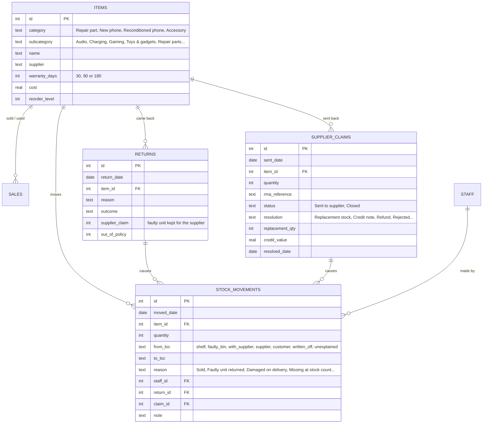
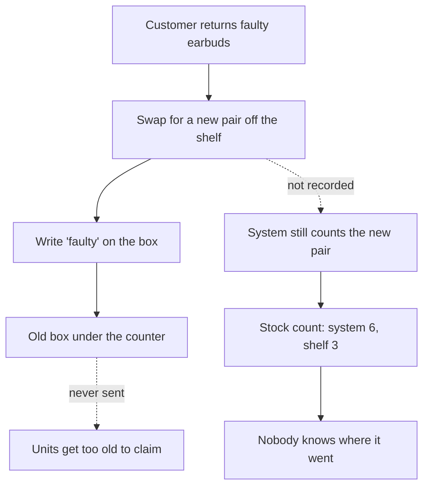
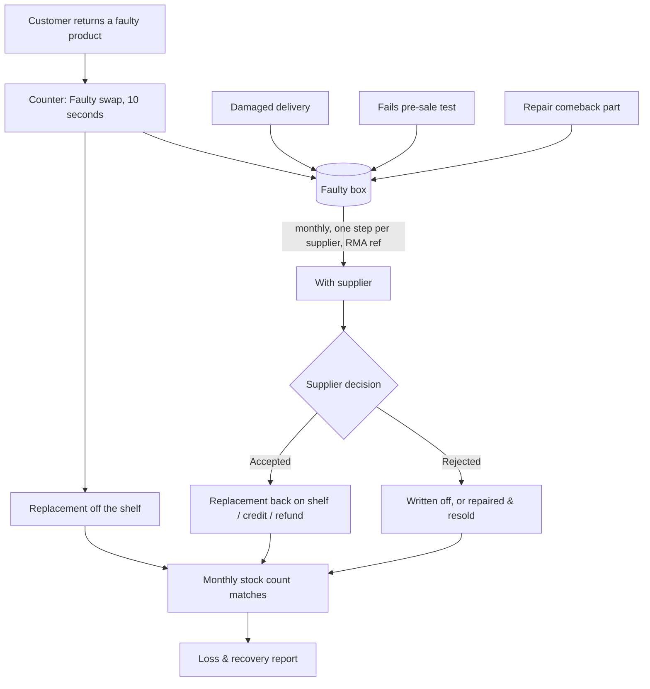

# Faulty Stock & Returns Tracker — Requirements

**Project:** Faulty stock, supplier returns and repair comebacks for a phone repair & electronics shop
**Author:** Sanjay Prakash Ravi
**Status:** v4.0

---

## 1. Problem statement

The shop repairs phones (Apple, Samsung, Google Pixel, OnePlus) and sells new and reconditioned phones, accessories, chargers, power banks, earbuds, smartwatches, gaming consoles and controllers, and toys and gadgets.

Some products fail a lot. **Wireless earbuds are the clearest case: 2 to 4 in every 10 come back faulty.** Today a faulty return is handled like this:

1. The customer brings it back, and staff swap it for a new one off the shelf (or refund it). The customer is happy.
2. "Faulty" is written on the box, and it goes into a box under the counter.
3. **The system is never told.** It still counts the replacement as being on the shelf, and the faulty unit doesn't exist anywhere.
4. **The faulty box never goes back to the supplier.** Nobody counts it, nobody chases a credit, and the units get too old to claim.
5. At reorder or stock-take time, the system says "you have 6" but the shelf has 3. *Where did they go? Who took them?*

The same thing happens with repair parts used but not deducted, deliveries that arrive damaged, and stock that fails testing before sale. **The result is a silent, unmeasured loss.** It doesn't show up anywhere, so nobody can recover it, raise it with suppliers, or decide to stop selling a bad product.

**Goal:** make the right thing the fastest thing at the counter. A faulty swap takes one 10-second step that keeps stock correct. Faulty stock is tracked until the supplier gives replacement stock or credit. The manager can see exactly how much was lost, recovered and still to recover, by product and by supplier.

### Success measures

| Measure | Before | Target |
|---|---|---|
| Faulty swaps recorded | ~30% | 100% |
| Time to record a swap at the counter | n/a | ≤ 10 seconds |
| Faulty stock returned to suppliers | Never | Monthly, every supplier |
| Supplier acceptance of claims | Low (old units, no proof) | > 75% |
| Unexplained stock difference at counts | Large and unknown | Near zero, every gap traceable |
| Loss and recovery visible to the manager | No | Live, by product and supplier |

---

## 2. Stakeholders

| Stakeholder | Role | Needs | Influence |
|---|---|---|---|
| **Sales staff** | Swap and refund faulty products at the counter, book in deliveries | One quick step; no paperwork; clear guidance on warranty | High (adoption depends on them) |
| **Technicians** | Repair phones, handle comebacks, use parts | Parts deducted per job; faulty parts tracked | High |
| **Shop manager / owner** | Buys stock, chooses suppliers, owns profit | Accurate stock, faulty box returned monthly, loss and recovery figures, supplier performance | High (decision maker) |
| **Suppliers** | Accept or reject faulty returns | Batched returns with RMA reference, quantities and dates | Indirect, but they decide recovery |
| **Customers** | Return faulty products | Quick, fair swap | Indirect |

---

## 3. Scope

**In scope:**
- Staff sign-in with roles.
- A counter page (faulty swap or refund, delivery in with damaged units, found faulty on the shelf).
- A stock ledger (shelf, faulty box, with supplier) with a full movement trail.
- Stock counts with variance.
- A faulty box with batched returns to suppliers and tracking of the supplier's decision.
- A loss & recovery report.
- Repair comebacks logged from the counter with warranty checks, and repair comeback rates on the manager's page.

The app has four pages: **Counter**, **Faulty box** and **Stock** for everyone, and **Money** for the manager.

**Out of scope:** POS integration (sales are entered by the till today), purchase orders, customer data, payments, multi-store accounts, barcode scanning (a good next step).

---

## 4. User stories and acceptance criteria

### Counter (sales staff)

**US-01: Faulty swap in one step**
As a sales staff member, I want to record a faulty swap in one action, so that the customer gets a new unit and stock stays correct without extra work.
- Pick the product (search or group), the fault, and what the customer gets: swap, refund or store credit.
- Saving a swap moves **1 replacement off the shelf** and **1 faulty unit into the faulty box**, recorded with my name and the date.
- A refund or store credit moves only the faulty unit into the bin.
- If none are left on the shelf, a swap can't be saved and the screen suggests a refund or credit.

**US-02: Warranty check at the counter**
- If the sale date is entered, days since sale and the product's warranty (30 or 90 days) are shown, and a warning appears outside warranty.
- No receipt is allowed and noted.

**US-03: Book in a delivery, including damaged units**
As a staff member, I want to book in a delivery and enter how many arrived damaged, so that damaged units go straight to the faulty box instead of the shelf.
- Units OK go to the shelf; damaged units go to the faulty box with the damage type.
- The screen shows the shelf before and after, and the value of damaged stock to claim.

**US-04: Faulty stock found on the shelf**
- Units that fail a pre-sale test or are found damaged move from the shelf to the faulty box, with a reason.

### Stock

**US-05: See where every unit is**
As the manager, I want each product's units on the shelf, in the faulty box and with suppliers, so that reorder decisions use real numbers.
- Low-stock flag at the reorder level; filter by group, search, and faulty units.

**US-06: Stock count with a trail**
As the manager, I want to count the shelf and see the difference against the system, so that missing stock is explained or recorded, not guessed.
- Shows the system figure, my count and the difference in units and €.
- Saving records the difference with my name, date and note.

**US-07: Who moved what**
As the manager, I want a movement history I can filter by item, movement type and staff member, so that I can answer "where did it go and who took it".

### Faulty box & suppliers

**US-08: Faulty box grouped by supplier**
- The bin is grouped by supplier, with units, value and how long the oldest unit has waited.
- Groups waiting over 30 days are highlighted, because suppliers often refuse old claims.

**US-09: Send to a supplier in one step**
As a staff member, I want to send everything in the bin for one supplier in one action, with their RMA reference, so that faulty stock actually goes back.
- Creates one claim line per product under one RMA reference and moves the units from the bin to "with supplier".

**US-10: Record what the supplier did**
- *New stock* (units back on the shelf), *Credit / refund* (amount), or *Refused*, then write off, or repair and resell (back on the shelf).

**US-11: Supplier scorecard**
- Per supplier: units and value sent, acceptance rate, average days to settle, value recovered and still open.

### Manager: loss & recovery

**US-12: Know the money**
As the manager, I want faulty stock value, recovered, still to recover, written off and unexplained, so that I know what the problem costs and what I'm getting back.

**US-13: Find the products that fail**
- Fault rate by product (came back faulty ÷ sold), defaulting to the period since go-live, when recording became reliable.
- Shows which supplier each product comes from, so the manager can ask for a faulty allowance, credit, or change product.

**US-14: See the impact of the change**
- A monthly view of value recorded as faulty, recovered from suppliers, and missing at stock counts, before and after go-live.
- Automatic insights: go-live count findings, old-box acceptance vs monthly returns, current bin value, worst product.

### Repairs (secondary)

**US-15: Repair parts deducted per job**
- Each repair uses one part from the shelf; a free re-repair uses another; the faulty part from a comeback goes into the faulty box.

**US-16: Repair comebacks with warranty and responsibility**
- Logged from the Counter: device · part · grade, reason, outcome, optional repair date; a 90-day warranty check; responsibility shown (part fault, workmanship, customer damage).

**US-17: Sign in with a role**
- Passwords are stored as salted hashes. Staff see Counter, Faulty box and Stock; the manager also sees Money. On the public demo, one-click demo accounts replace visible passwords.

---

## 5. Data model

**Design choice: a movement ledger, not a stock number.** Stock is never edited directly. Every unit that moves has a row with from/to, a reason, a date and a person, and stock in any location is simply the units moved in minus the units moved out. That's what makes "where did it go, who took it" answerable, and makes stock counts self-explaining.

---

## 6. Process: current vs future

### Current (as-is)

### Future (to-be)

---

## 7. Business rules

| ID | Rule |
|---|---|
| BR-01 | A faulty swap always records two movements: replacement shelf → customer and faulty unit customer → faulty box. |
| BR-02 | Damaged units in a delivery go to the faulty box, never to the shelf. |
| BR-03 | The faulty box is returned to each supplier at least monthly. Units waiting over 30 days are flagged. |
| BR-04 | Supplier outcomes: replacement stock goes back on the shelf; credit/refund is recorded as an amount; rejected units are written off or repaired and resold. |
| BR-05 | Stock counts never overwrite stock; the difference is recorded as a movement to or from "unexplained" with who, when and a note. |
| BR-06 | Product warranties: 30 days (cases, protectors, cables, wired earphones, mounts, straps, toys) or 90 days (chargers, power banks, earbuds, speakers, smartwatches, gaming, memory); repairs 90 days; reconditioned phones 180 days. |
| BR-07 | Fault rate = units returned faulty ÷ units sold, for the same product and period. |
| BR-08 | Values are at cost. Recovered = credit/refund amount + replacement units × cost + repaired & resold units × cost. |

---

## 8. Assumptions to confirm

1. Monthly supplier returns are practical for every supplier (some may want returns when a box is full).
2. Suppliers accept claims within roughly 90 days of sale when an RMA reference and date are provided.
3. Staff will use the Counter page for every swap if it takes 10 seconds or less.
4. Repair parts are tracked per device · part · grade.
5. Barcode scanning would be the next step to make the counter even faster.

---

## 9. Demo data

Generated only, using fictional staff and supplier names. It covers 6 months: about 8,000 sales and repair jobs, about 420 returns and comebacks, 10,000+ stock movements, and monthly supplier returns.

- **April to June (before the app):** only about 30% of faulty swaps are recorded, there's an old faulty box, a few repair parts aren't deducted, and nothing goes back to suppliers.
- **1 July (go-live):** a full stock count finds €6,249 missing; the old box explains 82 units and 79 repair parts were never deducted. Suppliers accept only 56% of the old box.
- **July to September:** monthly returns, 78% accepted, and month-end counts within 2 units.
