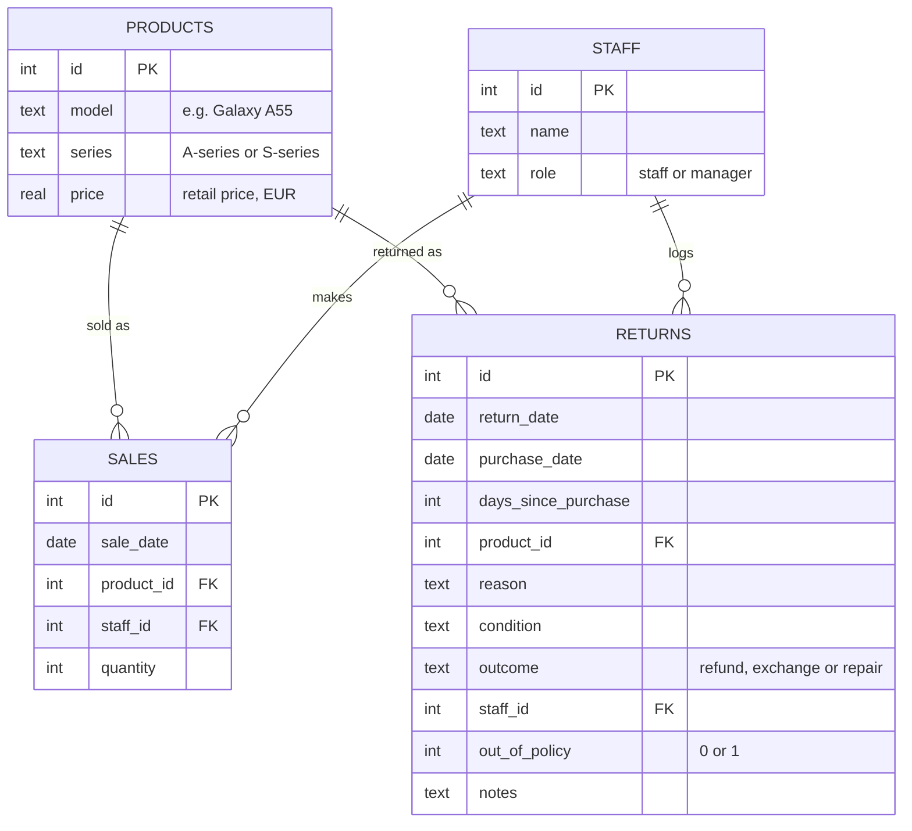
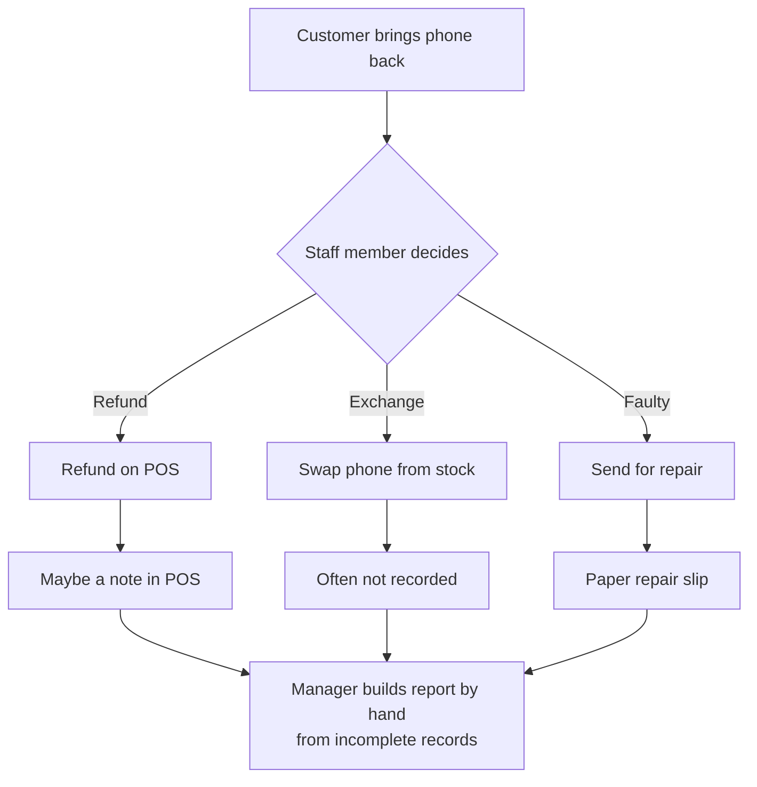
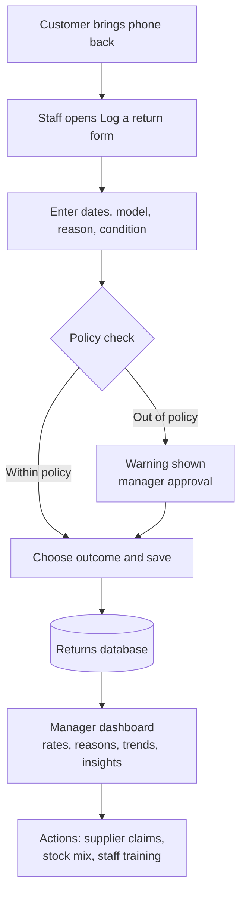

# Returns Tracker — Requirements

**Project:** Returns tracking and analysis for a Samsung phone retailer
**Author:** Sanjay Prakash Ravi
**Status:** v1.0 (built and deployed)

---

## 1. Problem statement

A phone shop selling Samsung Galaxy A-series and S-series phones handles several returns a week, but they are recorded inconsistently: on paper slips, in the POS notes field, or not at all when a phone is exchanged on the spot. As a result:

- **The manager can't answer basic questions:** which models come back most, why, and whether it's getting better or worse.
- **Refunds are given outside policy,** for example change-of-mind returns after 14 days, because staff can't easily check the rules at the counter.
- **Faulty-stock patterns are spotted late.** A batch with screen or battery faults is only noticed after customers complain repeatedly.
- **Return rates can't be compared fairly,** because returns are never linked to how many units of each model were sold.

**Goal:** give staff a 30-second way to log every return in a consistent format, and give the manager a dashboard that shows return rates, reasons and trends, so that stock, supplier and policy decisions are based on data.

### Success measures

| Measure | Target |
|---|---|
| Returns logged in the system | 100% of returns (vs. an estimated 60–70% today) |
| Time to log a return | Under 30 seconds |
| Out-of-policy refunds | Flagged at the counter before they happen |
| Manager reporting | Monthly return report available instantly instead of built by hand |

---

## 2. Stakeholders

| Stakeholder | Role | Needs | Influence |
|---|---|---|---|
| **Shop staff** | Process returns at the counter | Fast, simple form; clear guidance on policy; no double entry | High (daily users; adoption depends on them) |
| **Store manager** | Owns returns policy, stock and supplier relationships | Return rate by model, top reasons, trends, refund cost | High (decision maker, sponsor) |
| **Owner / area manager** | Oversees profitability across outlets | Monthly summary, refund value, comparison over time | Medium |
| **Customers** | Return or exchange a phone | Quick, fair, consistent handling | Indirect |
| **Samsung / supplier** | Handles warranty repairs and faulty-batch claims | Evidence of fault patterns by model | Indirect |

---

## 3. Scope

**In scope (v1):** logging returns, viewing and filtering the returns log, a manager dashboard with return rates by model, reasons, monthly trend and outcome split, automatic insights, and a 14-day policy check.

**Out of scope (v1):** POS integration, customer personal data, payment or refund processing, repair job tracking, multi-store login and permissions.

---

## 4. User stories and acceptance criteria

### Staff

**US-01: Log a return**
As a staff member, I want to log a return in one short form, so that every return is recorded consistently.
- **Given** I open the "Log a return" page, **when** I fill in the purchase date, return date, model, reason, condition, outcome and my name and press Save, **then** the return is stored and I see a confirmation.
- All fields except notes are required; the form can't be saved with any missing.
- The form works on a tablet or phone at the counter.

**US-02: Pick from standard options**
As a staff member, I want to choose the model, reason and condition from lists, so that I don't have to type and the data stays consistent.
- Model, reason, condition and outcome are dropdowns with fixed values (see the data model).
- Free text is only allowed in the optional notes field.

**US-03: See days since purchase automatically**
As a staff member, I want the system to calculate days since purchase from the two dates, so that I don't have to work it out.
- Days since purchase = return date − purchase date, shown before saving.
- A return date before the purchase date is rejected with an error message.

**US-04: Be warned about out-of-policy refunds**
As a staff member, I want a warning when a return is outside policy, so that I don't refund something I shouldn't.
- **Given** the reason is "Changed mind" and it's more than 14 days since purchase, **when** I choose "Refund", **then** a warning explains it's outside the 14-day policy and suggests manager approval.
- **Given** the reason is "Accidental damage", **when** I choose "Refund" or "Exchange", **then** a warning explains that accidental damage isn't covered.
- Warnings don't block saving (the manager may approve exceptions), but the return is flagged as out of policy.

### Store manager

**US-05: Browse and filter returns**
As the store manager, I want to filter the returns log by date range, model, reason, outcome and staff member, so that I can investigate specific cases.
- Filters can be combined; the table and the count update immediately.
- The filtered list can be downloaded as CSV.

**US-06: Compare return rates fairly**
As the store manager, I want to see the return rate per model (returns ÷ units sold), so that popular models don't look worse just because they sell more.
- Return rate is calculated per model for the selected period using the sales table.
- Models are sorted from highest to lowest return rate.

**US-07: See why phones come back**
As the store manager, I want to see the top return reasons, so that I can tell product faults from sales issues.
- Reasons are ranked by count with their share of all returns.
- Fault reasons (screen, battery, charging port) can be told apart from non-fault reasons (changed mind, wrong model, not as described).

**US-08: Track the trend**
As the store manager, I want to see returns and return rate by month, so that I know whether things are improving.
- A monthly chart shows the return rate for each month in the selected period.

**US-09: Understand the cost of returns**
As the store manager, I want to see the split between refunds, exchanges and repairs, and the total refunded value, so that I understand the financial impact.
- The outcome split is shown as counts and percentages.
- Refunded value = sum of the retail price of refunded phones.

**US-10: Get the headline without analysing charts**
As the store manager, I want the dashboard to summarise the key findings in plain sentences, so that I can act quickly.
- At least three automatically generated insights appear at the top: the model with the highest return rate, the top return reason and its share, and the month-on-month change.
- The insights update with the selected filters.

---

## 5. Data model

**Reference values**

| Field | Allowed values |
|---|---|
| Reason | Changed mind · Faulty – screen · Faulty – battery · Faulty – charging port · Not as described · Wrong model bought · Network / connectivity issue · Accidental damage |
| Condition | Sealed / unopened · Like new · Used – good · Damaged |
| Outcome | Refund · Exchange · Repair |

No customer personal data is stored.

---

## 6. Process: current vs future

### Current process (as-is)

**Pain points:** decisions depend on who is at the counter; exchanges often go unrecorded; there's no policy check; reporting is manual and incomplete.

### Future process (to-be)

---

## 7. Business rules

| ID | Rule |
|---|---|
| BR-01 | Change-of-mind returns are accepted for refund within 14 days of purchase; after that only exchange, at manager discretion. |
| BR-02 | Faulty phones are repaired or exchanged under warranty; a refund is possible if the fault appears within 30 days. |
| BR-03 | Accidental damage isn't covered by returns policy (repair is chargeable). |
| BR-04 | Return rate = returns ÷ units sold for the same model and period. |
| BR-05 | Every return must have a staff member recorded against it. |

---

## 8. Assumptions to confirm

These are based on typical Irish phone retail practice and should be checked against the real shop:

1. The 14-day change-of-mind window and the 30-day "faulty refund" window match shop policy.
2. The reason list covers almost all real returns (anything else goes in notes).
3. One phone per return (no multi-unit returns).
4. Staff are happy to log returns on the shop tablet or their phone.
5. The manager's main decisions are supplier claims, stock mix and staff training.

---

## 9. Demo data

The live demo uses generated data only: 6 months of sales across 10 Samsung models and about 300 returns, with return rates that differ realistically by model and reason. No real customer or shop data is used.
